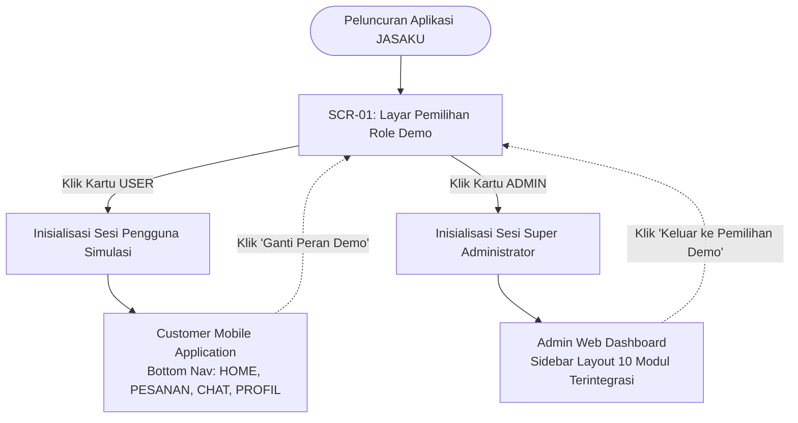
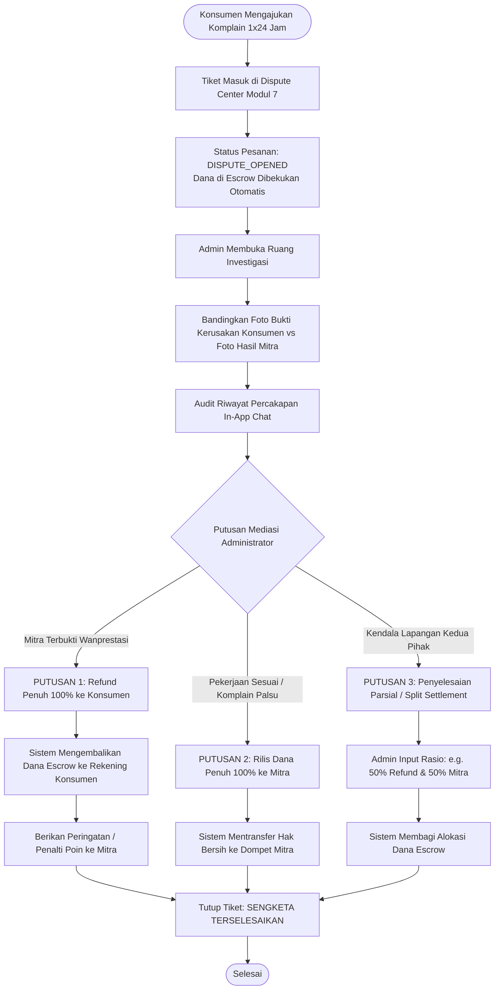
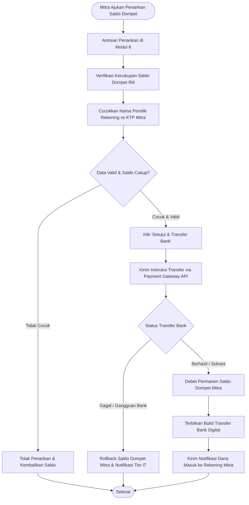

# PRODUCT REQUIREMENT DOCUMENT (PRD)
## SPESIFIKASI USER FLOW & ADMIN PANEL PLATFORM "JASAKU"

---

**INFORMASI DOKUMEN & PENGESAHAN:**
- **Nama Produk:** JASAKU (PT Jasaku Solusi Digital)
- **Tipe Dokumen:** Product Requirement Document (PRD) — Khusus User Flow & Admin Panel
- **Versi:** 1.0 (Demo Mode & Production Architecture Ready)
- **Status:** APPROVED & READY FOR WIREFRAMING / IMPLEMENTATION
- **Penanggung Jawab Produk & Stakeholders:**
  - **Krisnas Anugrah** (Chief Executive Officer / CEO)
  - **Junior Mokosolang** (Chief Technology Officer / CTO)
  - **Jabes Soedibyo** (Chief Operating Officer / COO)
  - **Alhillal Nabil** (Chief Marketing Officer / CMO)
  - **Yonathan Angkol** (Chief Financial Officer / CFO)
- **Tanggal Rilis:** November 2026
- **Dokumen Acuan:** `PROPOSAL_BUSINESS_PLAN_STARTUP_JASAKU_REVISI.docx` & `DATA INTERVIEW.xlsx` (50 Responden)

---

## DAFTAR ISI

1. [BAGIAN 1: RINGKASAN PRODUK & PRINSIP DEMO MODE](#bagian-1-ringkasan-produk--prinsip-demo-mode)
2. [BAGIAN 2: ARSITEKTUR PERAN & GLOBAL ENTRY FLOW](#bagian-2-arsitektur-peran--global-entry-flow)
3. [BAGIAN 3: USER FLOW SPESIFIKASI LENGKAP (CUSTOMER JOURNEY)](#bagian-3-user-flow-spesifikasi-lengkap-customer-journey)
4. [BAGIAN 4: ADMIN PANEL PRD — SPESIFIKASI MODUL & KEBUTUHAN FUNGSIONAL](#bagian-4-admin-panel-prd--spesifikasi-modul--kebutuhan-fungsional)
5. [BAGIAN 5: ADMIN WORKFLOW & LOGIKA INTERVENSI SISTEM](#bagian-5-admin-workflow--logika-intervensi-sistem)
6. [BAGIAN 6: SPESIFIKASI LAYAR ADMIN PANEL (SCREEN SPECS & DATA MATRIX)](#bagian-6-spesifikasi-layar-admin-panel-screen-specs--data-matrix)
7. [BAGIAN 7: BUSINESS LOGIC, ESCROW VAULT & PERHITUNGAN FINANSIAL](#bagian-7-business-logic-escrow-vault--perhitungan-finansial)
8. [BAGIAN 8: PERSYARATAN NON-FUNGSIONAL (NFR) & KEAMANAN SISTEM](#bagian-8-persyaratan-non-fungsional-nfr--keamanan-sistem)
9. [BAGIAN 9: ACCEPTANCE CRITERIA & DEFINITION OF DONE (DoD)](#bagian-9-acceptance-criteria--definition-of-done-dod)

---

# BAGIAN 1: RINGKASAN PRODUK & PRINSIP DEMO MODE

### 1.1 Latar Belakang & Masalah Produk
Berdasarkan hasil analisis empiris dari 50 responden (`DATA INTERVIEW.xlsx`):
- **92% responden** menyatakan kesulitan menemukan penyedia jasa yang terpercaya, jujur, dan bergaransi.
- **30% responden** memiliki ketakutan terbesar terhadap penipuan (*scam*) dan hilangnya uang saat diminta membayar uang muka (*prepayment*) tanpa kepastian pengerjaan.
- **26% responden** mengeluhkan ketidaktransparanan harga, di mana tarif sering dinaikkan secara sepihak saat teknisi tiba di lokasi.
- **16% responden** mengalami keterlambatan teknisi dan jadwal pengerjaan yang bentrok.

### 1.2 Solusi Nilai Tambah (Core Value Proposition)
Aplikasi **JASAKU** memecahkan seluruh masalah di atas melalui:
1. **Sistem Rekening Bersama (Escrow Vault System):** Dana pembayaran pelanggan ditahan 100% oleh sistem perbankan/payment gateway resmi dan baru diteruskan ke mitra setelah konsumen memverifikasi hasil pengerjaan.
2. **Katalog Tarif Terbuka & Transparan:** Rincian biaya dasar dipublikasikan di muka sebelum pemesanan.
3. **Kurasi Identitas Mitra (KYC):** Verifikasi KTP resmi dan portofolio keahlian, didukung standar mutu rating minimum 4.0 bintang.
4. **Alur Transaksi & Resolusi Sengketa Terpusat:** Admin memonitor seluruh transaksi secara *real-time* dan memediasi komplain dalam SLA 1x24 jam.

### 1.3 Prinsip Demo Mode (Prototipe Pengujian Cepat)
Untuk kebutuhan pengujian antarmuka dan presentasi evaluasi:
- **TIDAK ADA Form Login Sungguhan:** Pengguna tidak dibebani input email, password, OTP SMS/WhatsApp, tautan verifikasi, atau registrasi bertahap.
- **Halaman Pemilihan Role (Role Selection Gate):** Saat aplikasi pertama kali dimuat, sistem HANYA menyajikan **DUA TOMBOL PILIHAN**:
  1. **[USER]** -> Langsung membuka Customer Home Screen (data simulasi pelanggan terproteksi).
  2. **[ADMIN]** -> Langsung membuka Admin Web Dashboard (hak akses super admin terkonfigurasi).
- **Peniadaan Pilihan Provider pada Gerbang Demo:** Pihak penyedia jasa (mitra) diperlakukan sebagai entitas operasional bisnis yang disimulasikan dari sisi manajemen sistem dan dikontrol melalui modul Admin Panel.
- **Mekanisme Reset Demo:** Tombol *"Ganti Peran Demo"* persisten di profil Customer dan bilah navigasi atas Admin Panel untuk beralih peran kapan saja tanpa membersihkan memori aplikasi.


### 1.4 Design System, Logo & Palet Warna Resmi (Berdasarkan Logo Cuplikan Layar)
Desain visual seluruh antarmuka aplikasi JASAKU (Customer App & Admin Panel) wajib mengacu secara konsisten pada identitas visual resmi brand JASAKU:

```
+-----------------------------------------------------------------------------------+
|                     PALET WARNA RESMI BRAND STARTUP JASAKU                        |
+----------------------+------------+-----------------------------------------------+
| Elemen Brand         | Nilai HEX  | Penerapan & Peruntukan Antarmuka              |
+----------------------+------------+-----------------------------------------------+
| Primary Brand Color  | #16627A    | Deep Teal / Biru Samudera: Header, Active Tab,|
|                      |            | Tombol Utama (CTA), Banner Proteksi Rekber.   |
+----------------------+------------+-----------------------------------------------+
| Secondary / Accent   | #EE7A34    | Vibrant Orange / Amber: Tag Promo, Voucher,   |
|                      | (#F97316)  | Tombol 'Pesan Sekarang', Badge Diskon MHS.    |
+----------------------+------------+-----------------------------------------------+
| Neutral Dark (Text)  | #161717    | Dark Charcoal / Slate: Typography Judul &     |
|                      |            | Teks Utama untuk keterbacaan kontras tinggi.  |
+----------------------+------------+-----------------------------------------------+
| Neutral Light        | #F8FAFC    | Soft Slate Tint: Latar belakang aplikasi,     |
|                      | #FFFFFF    | kartu komponen, dan kontainer modular.        |
+----------------------+------------+-----------------------------------------------+
| State: Escrow Safe   | #10B981    | Emerald Green: Status pembayaran berhasil,    |
|                      |            | dana terkunci aman, dan transaksi selesai.    |
+----------------------+------------+-----------------------------------------------+
| State: In Dispute    | #F59E0B    | Amber Yellow: Status pesanan dalam sanggahan  |
|                      |            | atau mediasi peninjauan komplain admin.       |
+----------------------+------------+-----------------------------------------------+
```

- **Logo JASAKU:** Menampilkan tipografi tebal modern *"JASAKU"* yang berpadu dengan emblem perisai/alat jasa dengan kombinasi warna Deep Teal (`#16627A`) dan Vibrant Orange (`#EE7A34`).
- **Penempatan Navigasi Mutlak:**
  * **Customer App:** Navigasi **Bottom Navigation Bar wajib persisten di bagian paling bawah layar** (*fixed bottom*).
  * **Admin Panel:** Navigasi **Sidebar Menu wajib persisten di sebelah samping kiri** (*fixed left sidebar*).
---

# BAGIAN 2: ARSITEKTUR PERAN & GLOBAL ENTRY FLOW

### 2.1 Matriks Peran Pengguna (Role Architecture)



---

# BAGIAN 3: USER FLOW SPESIFIKASI LENGKAP (CUSTOMER JOURNEY)

Aplikasi Customer menggunakan arsitektur **Bottom Navigation Bar dengan TEPAT 4 MENU UTAMA**: `HOME`, `PESANAN`, `CHAT`, `PROFIL`. Seluruh siklus transaksi dirancang dengan aturan *3-taps to checkout* dan transparansi rekening bersama (*escrow*).

### 3.1 Flow Pemesanan Utama (End-to-End Booking to Payment Escrow)

```mermaid
flowchart TD
    Start([Pengguna di Home Screen]) --> SelectCat[Pilih 1 dari 5 Kategori Jasa]
    SelectCat --> ViewMitraList[Lihat Daftar Mitra Terdekat & Rating]
    ViewMitraList --> OpenMitraDetail[Buka Profil Mitra & Detail Paket Jasa]
    OpenMitraDetail --> ClickOrder[Tekan Tombol 'Pesan Sekarang']
    
    ClickOrder --> InputSchedule[Pilih Tanggal & Slot Waktu Kedatangan]
    InputSchedule --> InputAddress[Pilih / Masukkan Alamat & Titik Koordinat GPS]
    InputAddress --> OrderSummary[Tinjau Ringkasan Biaya Transparan:<br/>Tarif Jasa Dasar + Biaya Proteksi Rp2.000]
    
    OrderSummary --> ApplyVoucher{Gunakan Kupon Promo?}
    ApplyVoucher -->|Ya| DeductVoucher[Potong Diskon 'MHSBARU' -Rp15.000]
    ApplyVoucher -->|Tidak| FinalTotal[Total Tagihan Final]
    DeductVoucher --> FinalTotal
    
    FinalTotal --> ChoosePayment[Pilih Metode Bayar: QRIS / Virtual Account]
    ChoosePayment --> PayProcess[Pelanggan Menyelesaikan Pembayaran]
    PayProcess --> EscrowLocked[DANA DIKUNCI DI REKENING BERSAMA (ESCROW VAULT)]
    
    EscrowLocked --> NotifyMitra[Push Notifikasi ke Mitra: SLA 15 Menit Dimulai]
    NotifyMitra --> AwaitingConfirm([Status: MENUNGGU KONFIRMASI MITRA])
```

### 3.2 Flow Pelaksanaan Pengerjaan & Pelepasan Dana (Escrow Release)

```mermaid
flowchart TD
    AwaitingConfirm([Status: MENUNGGU KONFIRMASI]) --> MitraDecision{Mitra Respon dalam 15 Menit?}
    
    MitraDecision -->|Tolak / Timeout 15m| CancelAuto[Pesanan Dibatalkan Otomatis<br/>100% Refund Kembali ke Pelanggan]
    MitraDecision -->|Terima Pesanan| OrderAccepted[Status: PESANAN DITERIMA]
    
    OrderAccepted --> MitraOTW[Mitra Menekan 'Menuju Lokasi'<br/>Status: MITRA MENUJU LOKASI]
    MitraOTW --> MitraArrived[Mitra Tiba & Ambil Foto Kerusakan Awal]
    MitraArrived --> InProgress[Status: SEDANG BERLANGSUNG]
    
    InProgress --> WorkDone[Pekerjaan Fisik Lapangan Selesai]
    WorkDone --> UploadProof[Mitra Mengunggah Foto Bukti Kerja Tuntas]
    UploadProof --> WorkSubmitted[Status: MENUNGGU VERIFIKASI PELANGGAN]
    
    WorkSubmitted --> CustInspect{Pelanggan Memeriksa Hasil Kerja}
    CustInspect -->|Hasil Puas & Sesuai| ConfirmFinish[Pelanggan Klik 'Konfirmasi Selesai']
    CustInspect -->|Hasil Rusak / Kendala| FileDispute[Pelanggan Klik 'Ajukan Komplain 1x24 Jam']
    
    ConfirmFinish --> ReleaseEscrow[SISTEM MERILIS DANA DARI ESCROW VAULT]
    ReleaseEscrow --> SplitFunds[90% Saldo Dikreditkan ke Mitra<br/>10% Komisi + Rp2.000 Masuk Kas JASAKU]
    SplitFunds --> OrderClosed[Status: SELESAI (CLOSED)]
    OrderClosed --> GiveReview[Beri Skor Rating 1-5 Bintang & Ulasan Foto]
    
    FileDispute --> FreezeEscrow[DANA DI ESCROW DIBEKUKAN SEMENTARA]
    FreezeEscrow --> AdminMediation([Masuk ke Dispute Resolution Center Admin])
```

---

# BAGIAN 4: ADMIN PANEL PRD — SPESIFIKASI MODUL & KEBUTUHAN FUNGSIONAL

Admin Panel dirancang berbasis antarmuka web modern dengan struktur navigasi **Sidebar Layout 10 Modul**. Admin bertindak sebagai sentral kendali operasional, pengawas arus kas penampungan (*escrow*), dan mediator sengketa.

```
+-----------------------------------------------------------------------------------+
|                           NAVIGASI SIDEBAR ADMIN PANEL                            |
+----+----------------------------------+-------------------------------------------+
| No | Modul Navigasi                   | Deskripsi Fungsi Utama                    |
+----+----------------------------------+-------------------------------------------+
| 01 | Dashboard Overview & Live KPIs   | Monitor GMV, Transaksi, BEP 415, & Escrow |
| 02 | Verifikasi Mitra KYC             | Kurasi berkas pendaftaran KTP & keahlian  |
| 03 | Manajemen Master Mitra           | Direktori mitra, rating <4.0, suspend     |
| 04 | Manajemen Pengguna Customer      | Direktori pelanggan, audit akun, blacklist|
| 05 | Katalog Layanan & Konfigurasi    | Atur 5 kategori jasa, tarif dasar, komisi |
| 06 | Live Order & Audit Escrow Vault  | Feed transaksi live, audit saldo penampung|
| 07 | Dispute Resolution Center        | Mediasi komplain garansi, investigasi chat|
| 08 | Manajemen Payout Mitra           | Verifikasi & eksekusi pencairan saldo bank|
| 09 | Rekonsiliasi Finansial & Laporan | Buku besar 10% + fee, ekspor Excel/PDF    |
| 10 | Pengaturan Global & Audit Trail  | Parameter fee Rp2.000, SLA, log UU PDP    |
+----+----------------------------------+-------------------------------------------+
| -- | Keluar ke Pemilihan Demo         | Tombol reset sesi kembali ke SCR-01       |
+----+----------------------------------+-------------------------------------------+
```

---

### 4.1 Modul 1: Dashboard Overview & Live KPIs
- **Tujuan:** Memberikan visibilitas instan atas kesehatan finansial, operasional lapangan, dan traksi pertumbuhan startup secara *real-time*.
- **Kebutuhan Fungsional (FR):**
  1. *Widget Metrik Utama:*
     - **Gross Merchandise Value (GMV) Berjalan:** Total perputaran uang kotor transaksi.
     - **Net Platform Revenue:** Akumulasi pendapatan riil platform (Komisi 10% + Biaya Proteksi Rp2.000 per pesanan).
     - **Target BEP Monitor:** Indikator perbandingan volume order bulan berjalan terhadap target titik impas **415 transaksi per bulan**.
     - **Saldo Mengendap di Escrow Vault:** Total dana penampungan milik pihak ketiga yang sedang dikunci sistem.
     - **Total Pengguna & Mitra Aktif:** Jumlah akun terverifikasi.
  2. *Grafik Tren Transaksi:* Visualisasi volume transaksi harian, mingguan, dan bulanan.
  3. *Grafik Distribusi Kategori:* Persentase pesanan pada 5 kategori (Cleaning, AC, Elektronik, Rumah, Pindahan).
  4. *Urgent Action Feed:* Menampilkan kartu pengingat antrean prioritas (mitra butuh verifikasi, komplain belum selesai, permintaan payout menunggu transfer).

---

### 4.2 Modul 2: Verifikasi Mitra KYC (Pendaftaran & Kurasi)
- **Tujuan:** Menjamin seluruh penyedia jasa yang masuk ke katalog adalah individu resmi yang teridentifikasi legalitasnya guna mengeliminasi 30% ketakutan penipuan pelanggan.
- **Kebutuhan Fungsional (FR):**
  1. *Antrean Pengajuan:* Tabel dinamis calon mitra berstatus `KYC_PENDING`.
  2. *Inspeksi Berkas Digital:* Peninjauan foto KTP asli, foto selfie memegang KTP, sertifikat keahlian teknis / foto portofolio pekerjaan terdahulu.
  3. *Tombol Otorisasi:*
     - **Setujui (Approve):** Mengubah status mitra menjadi `PARTNER_ACTIVE` dan mempublikasikan profilnya ke direktori aplikasi pelanggan.
     - **Tolak (Reject):** Mengubah status menjadi `REJECTED_REVISION` dan mewajibkan admin mengisi catatan alasan penolakan (misal: *Foto KTP tidak terbaca, NIK tidak sesuai*).

---

### 4.3 Modul 3: Manajemen Master Mitra (Provider Management)
- **Tujuan:** Mengawasi kualitas layanan, memelihara standar etos kerja mitra, dan menegakkan sanksi kedisiplinan.
- **Kebutuhan Fungsional (FR):**
  1. *Tabel Direktori Mitra:* Menampilkan Nama, Nomor Kontak, Kategori Spesialisasi, Jumlah Transaksi Tuntas, Saldo Dompet Terkini, dan Skor Rating.
  2. *Peringatan Kualitas Otomatis:* Mitra dengan rata-rata rating di bawah **4.0 bintang** otomatis ditandai badge kuning; rating di bawah **3.5 bintang** otomatis masuk antrean pembinaan.
  3. *Aksi Intervensi:*
     - **Suspend Akun:** Menonaktifkan mitra sementara (3–7 hari) atau permanen jika terbukti mengajak transaksi di luar aplikasi (*disintermediasi*).
     - **Aktifkan Kembali (Reactivate):** Memulihkan hak akses mitra pasca pembinaan oleh tim operasional.

---

### 4.4 Modul 4: Manajemen Pengguna (Customer Directory)
- **Tujuan:** Mengelola basis data konsumen dan mencegah aktivitas kecurangan (*fraudulent behavior*).
- **Kebutuhan Fungsional (FR):**
  1. *Direktori Konsumen:* Menampilkan identitas simulasi, riwayat frekuensi pemesanan, total nilai pembelanjaan, dan catatan komplain.
  2. *Tindakan Blacklist / Blokir:* Menonaktifkan akun pengguna yang terindikasi melakukan pemesanan fiktif berulang atau berperilaku kasar terhadap mitra teknisi.

---

### 4.5 Modul 5: Katalog Layanan & Konfigurasi Tarif
- **Tujuan:** Mengendalikan transparansi harga dasar dan batas persentase komisi startup.
- **Kebutuhan Fungsional (FR):**
  1. *Daftar 5 Kategori Jasa:* Cleaning Service, Service AC, Perbaikan Elektronik, Perbaikan Rumah, Jasa Pindahan.
  2. *Pengaturan Parameter per Kategori:*
     - Tarif Dasar Standar (Floor Price & Ceiling Price).
     - Persentase Komisi Platform (default: **10%**).
     - Estimasi Durasi Pengerjaan Standar.
  3. *Emergency Toggle:* Tombol penonaktifan sementara kategori tertentu saat terjadi cuaca ekstrem atau kendala ketersediaan logistik.

---

### 4.6 Modul 6: Live Order Feed & Audit Escrow Vault
- **Tujuan:** Pengawasan transaksional waktu-nyata (*real-time*) dan penjaminan 0% kebocoran dana rekening bersama.
- **Kebutuhan Fungsional (FR):**
  1. *Live Order Tracker:* Menampilkan status seluruh pesanan berjalan secara *real-time* (`AWAITING_CONFIRMATION`, `ACCEPTED`, `OTW`, `IN_PROGRESS`, `WORK_SUBMITTED`, `DISPUTE`).
  2. *Escrow Balance Reconciler:* Memastikan total nilai kas yang ditahan di bank penampung identik dengan penjumlahan nilai pesanan aktif di database.
  3. *Force Intervention (Manual Override):* Otorisasi khusus admin untuk membatalkan atau menyelesaikan transaksi macet akibat kendala jaringan lapangan dengan kewajiban mengisi berita acara resmi.

---

### 4.7 Modul 7: Dispute Resolution Center (Penanganan Sengketa & Garansi)
- **Tujuan:** Menuntaskan perselisihan antara konsumen dan mitra secara adil berdasarkan fakta digital dalam masa garansi 1x24 jam.
- **Kebutuhan Fungsional (FR):**
  1. *Antrean Tiket Komplain:* Menampilkan tiket berstatus `DISPUTE_OPENED` dengan indikator SLA waktu tanggap maksimal 24 jam.
  2. *Ruang Investigasi Terpadu (Inspection Room):*
     - Menampilkan uraian kronologi masalah dari konsumen.
     - Menampilkan perbandingan foto kerusakan awal vs foto bukti kerja tuntas dari mitra vs foto komplain konsumen.
     - Akses audit transkrip percakapan in-app chat antara kedua belah pihak.
  3. *Tiga Opsi Putusan Admin:*
     - **Putusan 1: Refund Penuh 100% ke Pelanggan.** Diterbitkan jika terbukti mitra wanprestasi atau merusak properti.
     - **Putusan 2: Rilis Dana Penuh 100% ke Mitra.** Diterbitkan jika komplain konsumen tidak terbukti.
     - **Putusan 3: Penyelesaian Parsial (Split Resolution).** Pembagian dana secara proporsional sesuai kesepakatan mediasi (misal: 50% refund, 50% ganti biaya transport/material teknisi).

---

### 4.8 Modul 8: Manajemen Payout Mitra (Pencairan Saldo Dompet)
- **Tujuan:** Memproses mutasi penarikan dana hak bersih mitra dari dompet aplikasi ke rekening bank riil secara aman dan akuntabel.
- **Kebutuhan Fungsional (FR):**
  1. *Antrean Penarikan Saldo:* Menampilkan ID Mitra, Nama Bank (BCA, Mandiri, BRI, BNI), Nomor Rekening, Nama Pemilik, dan Jumlah Penarikan (Rp).
  2. *Validasi Otomatis:* Pengecekan kesesuaian nama pada buku tabungan bank dengan identitas KTP terverifikasi.
  3. *Eksekusi Payout:*
     - Tombol **Setujui & Transfer Bank** (Integrasi API Disbursement Payment Gateway).
     - Debet otomatis saldo dompet mitra dan penerbitan bukti transfer digital.
     - Tombol **Tolak Permintaan** disertai alasan (misal: *Nomor rekening tidak valid*).

---

### 4.9 Modul 9: Rekonsiliasi Finansial & Laporan Keuangan
- **Tujuan:** Menyediakan pembukuan akuntansi otomatis untuk evaluasi CFO Yonathan Angkol dan pertanggungjawaban operasional.
- **Kebutuhan Fungsional (FR):**
  1. *Buku Besar Pendapatan Platform (General Ledger):*
     - Memisahkan dana titipan konsumen di Escrow Vault.
     - Mengakumulasi pendapatan komisi 10% per transaksi selesai.
     - Mengakumulasi pendapatan biaya proteksi flat Rp2.000 per transaksi.
     - Mencatat beban variabel payment gateway Rp1.200 per transaksi.
     - Menghitung Margin Kontribusi Bersih riil (Rp12.800 per transaksi rata-rata).
  2. *Generator Ekspor Laporan:* Pengunduhan laporan keuangan berkala dalam format Microsoft Excel (.xlsx) dan PDF resmi.

---

### 4.10 Modul 10: Pengaturan Global & Audit Trail Keamanan
- **Tujuan:** Mengonfigurasi parameter sistem global dan mematuhi kepatuhan regulasi UU Perlindungan Data Pribadi (UU No. 27/2022).
- **Kebutuhan Fungsional (FR):**
  1. *Pengaturan Biaya & Waktu Sistem:*
     - Besar Biaya Proteksi Platform (default: Rp2.000).
     - SLA Konfirmasi Pesanan Mitra (default: 15 menit).
     - Batas Waktu Auto-Release Dana (default: 2x24 jam).
     - Batas Garansi Komplain Pelanggan (default: 1x24 jam).
  2. *Log Audit Trail Tak Terhapuskan (Immutable Logs):* Merekam setiap aksi administratif sensitif (verifikasi KYC, intervensi putusan sengketa, perubahan tarif, eksekusi transfer payout) lengkap dengan alamat IP, timestamp, dan identitas administrator.

---

# BAGIAN 5: ADMIN WORKFLOW & LOGIKA INTERVENSI SISTEM

### 5.1 Alur Verifikasi Dokumen KYC Calon Mitra

```mermaid
flowchart TD
    StartKYC([Calon Mitra Mengajukan Berkas]) --> Queue[Antrean Verifikasi Mitra di Modul 2]
    Queue --> OpenDoc[Admin Membuka Detail Pengajuan]
    OpenDoc --> InspectKTP[Periksa KTP Asli & Kesesuaian NIK]
    InspectKTP --> InspectSelfie[Periksa Foto Selfie & Sertifikat Keahlian]
    
    InspectSelfie --> AdminDecision{Keputusan Verifikasi Admin}
    AdminDecision -->|Berkas Valid & Jelas| ApproveAction[Klik 'Setujui Mitra (Approve)']
    AdminDecision -->|Berkas Buram / Meragukan| RejectAction[Klik 'Tolak Pengajuan (Reject)']
    
    ApproveAction --> UpdateActive[Status Mitra: PARTNER_ACTIVE<br/>Tampil di Katalog Pencarian Konsumen]
    UpdateActive --> PushAccept[Kirim Notifikasi Penerimaan Resmi ke Mitra]
    
    RejectAction --> InputReason[Wajib Tulis Catatan Alasan Penolakan]
    InputReason --> UpdateRevision[Status Mitra: REJECTED_REVISION]
    UpdateRevision --> PushReject[Kirim Notifikasi Revisi ke Calon Mitra]
    
    PushAccept --> EndKYC([Selesai])
    PushReject --> EndKYC
```

### 5.2 Alur Mediasi Sengketa di Dispute Resolution Center



### 5.3 Alur Otorisasi & Eksekusi Payout Mitra



---

# BAGIAN 6: SPESIFIKASI LAYAR ADMIN PANEL (SCREEN SPECS & DATA MATRIX)

Tabel berikut merinci spesifikasi antarmuka, komponen input, tombol aksi, serta validasi untuk setiap layar modul Admin Panel:

| Screen ID & Nama Layar | Modul Terkait | Komponen UI Utama | Input & Data Display | Tombol Aksi / CTA Utama | Aturan Validasi & Error Handling |
| :--- | :---: | :--- | :--- | :--- | :--- |
| **SCR-A01**<br/>Dashboard Overview | Modul 1 | • 5 KPI Metric Cards<br/>• Grafik GMV & Transaksi<br/>• Pie Chart Kategori<br/>• Kotak Urgent Tasks | • Nilai GMV Bulan Ini<br/>• Net Revenue Platform<br/>• Progres BEP 415 order<br/>• Saldo Escrow Vault<br/>• Total User & Mitra | • Filter Periode Tanggal<br/>• Klik Kartu Tugas Cepat<br/>• Unduh Ringkasan Cepat | Saldo Escrow wajib seimbang dengan nilai total order aktif. |
| **SCR-A02**<br/>KYC Verification Queue | Modul 2 | • Tabel Antrean Berkas<br/>• Filter Kategori Keahlian<br/>• Status Badge (Pending)<br/>• Tombol Tinjau Berkas | • ID Pendaftaran, Nama Mitra, Nomor Telepon, Spesialisasi, Tanggal Submit | • Tombol 'Tinjau Berkas'<br/>• Filter Status Pengajuan | Data pengajuan wajib memiliki minimal 2 berkas foto digital. |
| **SCR-A03**<br/>KYC Inspection Modal | Modul 2 | • Image Viewer (Zoom KTP)<br/>• Foto Selfie dengan KTP<br/>• Portofolio Hasil Kerja<br/>• Form Catatan Alasan | • NIK, Nama Lengkap KTP, Alamat, Kategori Jasa | • Tombol 'Setujui Mitra'<br/>• Tombol 'Tolak Pengajuan'<br/>• Tombol 'Tutup' | Wajib memasukkan teks alasan penolakan sebelum tombol tolak dapat diklik. |
| **SCR-A04**<br/>Partner Master Directory | Modul 3 | • Tabel Master Seluruh Mitra<br/>• Kolom Rating Rata-rata<br/>• Badge Peringatan Kualitas<br/>• Dropdown Menu Aksi | • ID Mitra, Nama, Kategori, Total Order, Rating, Saldo Dompet, Status Akun | • Tombol 'Suspend Akun'<br/>• Tombol 'Aktifkan Kembali'<br/>• Tombol 'Lihat Riwayat' | Mitra dengan rating < 4.0 otomatis ditandai badge kuning sistem. |
| **SCR-A05**<br/>Customer Master Directory | Modul 4 | • Tabel Basis Data Konsumen<br/>• Kolom Total Transaksi<br/>• Kolom Akumulasi GMV<br/>• Tombol Manajemen Akun | • ID Konsumen, Nama, Kontak, Frekuensi Order, Riwayat Komplain, Status | • Tombol 'Blokir Pengguna'<br/>• Tombol 'Buka Blokir'<br/>• Tombol 'Audit Transaksi' | Konfirmasi ganda (*double confirmation dialog*) sebelum memblokir akun. |
| **SCR-A06**<br/>Service Catalog & Pricing | Modul 5 | • Tabel 5 Kategori Jasa<br/>• Form Tarif Dasar Min/Max<br/>• Field Komisi Platform (10%)<br/>• Switch Toggle Layanan | • Nama Kategori, Tarif Dasar (Rp), Durasi Kerja, Persentase Komisi (%) | • Tombol 'Ubah Parameter'<br/>• Toggle 'Non-aktifkan'<br/>• Tombol 'Simpan Perubahan' | Tarif dasar tidak boleh kurang dari Rp30.000; komisi platform default 10%. |
| **SCR-A07**<br/>Live Order & Escrow Audit | Modul 6 | • Feed Transaksi Real-Time<br/>• Monitor Saldo Escrow Vault<br/>• Kolom Posisi Dana Rekber<br/>• Tombol Override Darurat | • No Order, Nama Mitra & User, Nilai Jasa, Status Alur Kerja, Status Escrow | • Tombol 'Intervensi Manual'<br/>• Filter Pesanan Terkendala | Tindakan override manual mewajibkan pengisian berita acara nomor tiket. |
| **SCR-A08**<br/>Dispute Ticket Queue | Modul 7 | • Tabel Antrean Sengketa<br/>• SLA Timer Countdown (24j)<br/>• Badge Kategori Masalah<br/>• Tombol Buka Mediasi | • ID Tiket, No Pesanan Terkait, Nilai Dana Tertahan, Waktu Pengajuan | • Tombol 'Buka Ruang Mediasi'<br/>• Filter Tiket 'Urgent SLA' | Tiket dengan sisa waktu SLA < 4 jam otomatis dipindahkan ke baris teratas. |
| **SCR-A09**<br/>Dispute Investigation Room | Modul 7 | • Media Viewer Bukti Komplain<br/>• Media Viewer Bukti Kerja<br/>• Audit Transkrip In-App Chat<br/>• 3 Radio Button Putusan | • Foto Before/After Mitra, Foto Kerusakan Konsumen, Log Percakapan Chat | • Tombol 'Eksekusi Putusan'<br/>• Input Rasio Split (%) | Pada opsi split, rasio pembagian konsumen dan mitra wajib berjumlah 100%. |
| **SCR-A10**<br/>Partner Payout Queue | Modul 8 | • Tabel Antrean Penarikan Dana<br/>• Kolom Verifikasi Bank<br/>• Jumlah Nominal Penarikan<br/>• Tombol Persetujuan Transfer | • ID Mitra, Nama Bank, Nomor Rekening, Nama Pemilik, Nominal Tarik, Sisa Saldo | • Tombol 'Setujui & Transfer'<br/>• Tombol 'Tolak Penarikan' | Nama pemilik rekening bank tujuan wajib sama persis dengan nama pada KTP mitra. |
| **SCR-A11**<br/>Financial Ledger & Export | Modul 9 | • Buku Besar Rekonsiliasi<br/>• Breakdown Komisi 10%<br/>• Breakdown Biaya Rekber Rp2rb<br/>• Export Tools (Excel/PDF) | • Nilai GMV Bersih, Net Platform Revenue, Biaya Payment Gateway, Margin Bersih | • Tombol 'Ekspor Excel (.xlsx)'<br/>• Tombol 'Cetak Dokumen PDF' | Format penanggalan laporan otomatis mengikuti standar akuntansi keuangan. |
| **SCR-A12**<br/>Settings & Audit Trail | Modul 10 | • Global Parameters Form<br/>• Tabel Riwayat Log Audit<br/>• Filter Waktu & ID Admin | • Biaya Proteksi (Rp2.000), SLA Respon (15 Menit), Auto-Release (48 Jam), Log IP | • Tombol 'Simpan Parameter'<br/>• Tombol 'Filter Log Keamanan' | Kepatuhan UU PDP No. 27/2022: Log keamanan bersifat permanen (*read-only*). |

---

# BAGIAN 7: BUSINESS LOGIC, ESCROW VAULT & PERHITUNGAN FINANSIAL

### 7.1 Formula Finansial Transaksi Platform (Model Proposal Bab XI)
Struktur finansial aplikasi JASAKU ditanamkan secara presisi pada logika transaksi sistem:

$$\text{Total Invoice Pelanggan} = \text{Tarif Jasa Dasar Mitra} + \text{Biaya Proteksi Platform (Rp2.000)}$$

*Parameter Matematis Finansial:*
1. **Nilai Pesanan Rata-rata (Average Order Value / AOV):** **Rp120.000**
2. **Potongan Komisi Platform (10%):** Rp120.000 x 10% = **Rp12.000**
3. **Biaya Jasa Aplikasi / Proteksi Escrow:** Flat **Rp2.000** per transaksi dari pelanggan.
4. **Hak Bersih Saldo Mitra (90%):** Rp120.000 - Rp12.000 = **Rp108.000**
5. **Pendapatan Kotor Platform (Gross Revenue):** Rp12.000 + Rp2.000 = **Rp14.000 per transaksi**
6. **Biaya Variabel Payment Gateway:** **Rp1.200 per transaksi**
7. **Margin Kontribusi Bersih Platform:** Rp14.000 - Rp1.200 = **Rp12.800 per transaksi**
8. **Beban Biaya Tetap Bulanan (Fixed Cost):** **Rp5.300.000** (Server cloud, pemasaran rutin, pulsa/hotline, insentif tim CS).
9. **Titik Impas (Break-Even Point / BEP):**
   $$\text{BEP Volume} = \frac{\text{Rp5.300.000}}{\text{Rp12.800}} = 414,06 \approx 415 \text{ transaksi per bulan}$$
   $$\text{BEP GMV} = 415 \times \text{Rp120.000} = \text{Rp49.800.000 per bulan}$$

### 7.2 Mesin Status Transaksi (State Machine Matrix)
Sistem beroperasi berdasarkan 15 status transisi yang terkunci:

| No | Kode Status (State Code) | Definisi Operasional | Posisi Dana di Escrow Vault | Tindakan Pemicu Transisi |
| :-: | :--- | :--- | :--- | :--- |
| 1 | `PAYMENT_PENDING` | Menunggu pembayaran pelanggan via QRIS/VA (15 mnt). | Belum Masuk | Pelanggan memilih metode bayar di checkout. |
| 2 | `AWAITING_CONFIRMATION` | Pembayaran sukses; menunggu konfirmasi mitra (SLA 15 mnt). | `FUNDS_DEPOSITED_ESCROW` | Gateway mengirim webhook bayar sukses. |
| 3 | `ORDER_ACCEPTED` | Mitra menyetujui jadwal kedatangan. | `FUNDS_DEPOSITED_ESCROW` | Mitra menekan tombol 'Terima Pesanan'. |
| 4 | `PARTNER_ON_THE_WAY` | Mitra dalam perjalanan menuju alamat pelanggan. | `FUNDS_DEPOSITED_ESCROW` | Mitra menekan tombol 'Menuju Lokasi'. |
| 5 | `IN_PROGRESS` | Mitra tiba di lokasi & mulai pengerjaan fisik. | `FUNDS_DEPOSITED_ESCROW` | Mitra foto kerusakan awal & klik 'Mulai Kerja'. |
| 6 | `WORK_SUBMITTED` | Pekerjaan fisik beres; menunggu verifikasi konsumen. | `FUNDS_DEPOSITED_ESCROW` | Mitra mengunggah foto hasil kerja tuntas. |
| 7 | `ORDER_COMPLETED` | Konsumen menyetujui hasil kerja; dana dirilis. | `RELEASED_TO_PARTNER` | Konsumen klik 'Konfirmasi Selesai' / Auto 48j. |
| 8 | `DISPUTE_OPENED` | Konsumen mengajukan klaim garansi dalam 1x24 jam. | `FUNDS_FROZEN_ESCROW` | Konsumen mengunggah bukti foto komplain. |
| 9 | `RESOLVED_REFUNDED` | Mediasi admin memutuskan refund 100% ke konsumen. | `REFUNDED_TO_CUSTOMER` | Admin memilih Putusan 1 di Dispute Center. |
| 10| `RESOLVED_RELEASED` | Mediasi admin memutuskan rilis 100% ke mitra. | `RELEASED_TO_PARTNER` | Admin memilih Putusan 2 di Dispute Center. |
| 11| `RESOLVED_SPLIT` | Mediasi admin memutuskan pembagian dana proporsional. | `SPLIT_DISBURSED` | Admin memilih Putusan 3 (rasio split). |
| 12| `CANCELLED_NO_PARTNER`| Mitra tolak pesanan / waktu 15 mnt habis. | `REFUNDED_TO_CUSTOMER` | Sistem batalkan otomatis & refund 100%. |
| 13| `CANCELLED_BY_USER` | Konsumen membatalkan sebelum mitra menuju lokasi. | `REFUNDED_TO_CUSTOMER` | Konsumen klik batalkan tanpa penalti. |
| 14| `CANCELLED_WITH_PENALTY`| Konsumen membatalkan saat mitra sudah di jalan. | `PARTIAL_SETTLEMENT` | Potong Rp10rb transport mitra; sisa refund. |
| 15| `ORDER_CLOSED` | Ulasan bintang & testimoni dikirim; transaksi arsip. | `SETTLED` | Konsumen mengirimkan skor rating & ulasan. |

---

# BAGIAN 8: PERSYARATAN NON-FUNGSIONAL (NFR) & KEAMANAN SISTEM

1. **Performa Sistem & Ketersediaan (Performance & Availability):**
   - Waktu muat halaman (*page load time*) aplikasi mobile dan admin panel maksimal **2.0 detik** pada koneksi 4G standar.
   - Ketersediaan sistem (*system uptime*) dijamin minimal **99.5%** didukung oleh infrastruktur cloud dengan mekanisme *auto-scaling*.
2. **Kepatuhan Privasi Data & Regulasi Hukum (UU PDP No. 27/2022):**
   - Seluruh data identitas pribadi sensitif (foto KTP, NIK, nomor rekening bank) dienkripsi menggunakan standar industri **AES-256** pada basis data (*at rest*) dan protokol **TLS 1.3** saat pengiriman data (*in transit*).
   - Fitur in-app chat menerapkan sensor otomatis untuk memblokir pertukaran nomor rekening pribadi secara langsung, mencegah kebocoran data sekaligus transaksi di luar platform.
3. **Integritas Audit Trail:**
   - Seluruh tindakan mutasi keuangan, penolakan/persetujuan berkas KYC, dan keputusan mediasi sengketa dicatat dalam tabel audit log yang bersifat *immutable* (tidak dapat diubah atau dihapus oleh siapapun).

---

# BAGIAN 9: ACCEPTANCE CRITERIA & DEFINITION OF DONE (DoD)

### 9.1 Kriteria Keberhasilan Fungsional (Gherkin Syntax)

- **Skenario 1: Demo Role Selection (Gerbang Masuk Prototipe)**
  - *Given:* Pengguna membuka aplikasi JASAKU pada perangkat uji.
  - *When:* Layar menampilkan pilihan role demo.
  - *Then:* Hanya terdapat 2 pilihan kartu yaitu USER dan ADMIN tanpa form login/password/OTP, dan menekan kartu USER langsung mengarahkan ke Customer Home Screen dengan 4 Bottom Navigation Bar.

- **Skenario 2: Alur Pembayaran Rekening Bersama (Escrow Hold)**
  - *Given:* Pelanggan berada di halaman checkout pemesanan servis AC senilai Rp120.000 + Biaya Proteksi Rp2.000.
  - *When:* Pelanggan menyelesaikan pembayaran via QRIS dinamis.
  - *Then:* Webhook gateway memvalidasi sukses, dana Rp122.000 dikunci di Escrow Vault, pesanan berubah menjadi `AWAITING_CONFIRMATION`, dan timer SLA 15 menit mitra dimulai.

- **Skenario 3: Alur Rilis Dana Otomatis ke Saldo Mitra**
  - *Given:* Teknisi telah mengunggah foto bukti kerja beres dan status berada pada `WORK_SUBMITTED`.
  - *When:* Pelanggan menekan tombol 'Konfirmasi Selesai'.
  - *Then:* Sistem memotong komisi 10% (Rp12.000), mengkreditkan Rp108.000 ke saldo dompet mitra, membukukan Rp14.000 ke kas platform, dan membuka form rating ulasan.

- **Skenario 4: Mediasi Komplain Garansi di Admin Panel**
  - *Given:* Pelanggan mengajukan komplain garansi pengerjaan dalam tempo 1x24 jam dengan melampirkan foto kerusakan lanjutan.
  - *When:* Administrator memeriksa bukti foto & log chat lalu memilih 'Putusan Refund Penuh 100%'.
  - *Then:* Dana di Escrow Vault otomatis dikembalikan ke rekening pelanggan, tiket sengketa ditutup, dan mitra diberikan catatan penalti.

---

### 9.2 Definisi Selesai (Definition of Done — DoD)
Spesifikasi User Flow dan Admin Panel dinyatakan tuntas dan siap memasuki tahap perancangan visual jika:
1. Seluruh 23 alur transaksi Customer dan 26 alur kerja Admin Panel telah terpetakan tanpa kebuntuan navigasi (*no dead-ends*).
2. Tepat 4 Menu Bottom Navigation Bar (*HOME, PESANAN, CHAT, PROFIL*) konsisten pada aplikasi pengguna.
3. Seluruh kebutuhan pengawasan finansial (komisi 10%, proteksi Rp2.000, BEP 415 transaksi) terintegrasi pada modul Admin Panel.
4. Spesifikasi fungsional disetujui bersama oleh seluruh dewan pendiri JASAKU.

---
*Dokumen Resmi PRD User Flow & Admin Panel JASAKU v1.0 — PT Jasaku Solusi Digital.*
